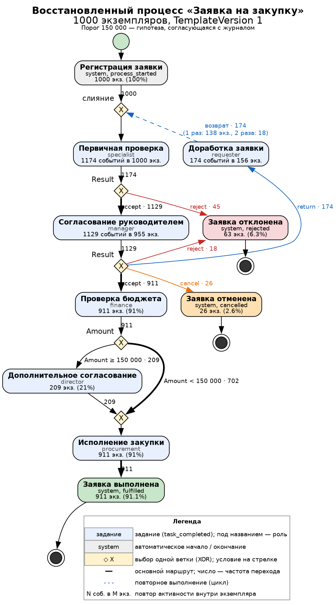

# Задача 2. Восстановление процесса по журналу событий

Учебная практика, 2 курс. По завершённым историям заявок восстановлены действия, переходы, развилки, возвраты и окончания процесса.

## Результат

Из 6 508 событий и 1 000 экземпляров получены **8 вариантов выполнения, 12 непосредственных переходов и 3 окончания**. Частоты и условия развилок проверены по исходному журналу. Дополнительно построены DFG и сеть Alpha, показаны их ограничения.



- [Условие](<task (2).md>) и [описание данных](<dataset_description (2).md>).
- [Решение](report.md), [PDF-отчёт](report.pdf).
- [Варианты](variants.csv), [переходы](student_transitions.csv).
- [Схема SVG](process_model.svg), [DFG](dfg.png), [сеть Alpha](alpha_net.png).
- [Синтетический журнал](<students (2).csv>), [код](analyze.py), [вывод расчёта](run_log.txt).

## Запуск

Нужны Python 3, pandas и установленный Graphviz с командой `dot` в PATH.

```bash
python3 -m pip install -r requirements.txt
python3 analyze.py
```

Команда пересоздаёт таблицы, схемы и `run_log.txt`. Условие суммы около 150 000 согласуется с данными, но точная граница не доказана. Редкий маршрут не считается автоматически ошибкой.

## Остальные материалы практики

[Задача 1](https://github.com/kiwzux/practice-task-1) · [Задача 3](https://github.com/kiwzux/practice-task-3) · [Общий solution.md](https://github.com/kiwzux/practice-solutions/blob/main/solution.md).
