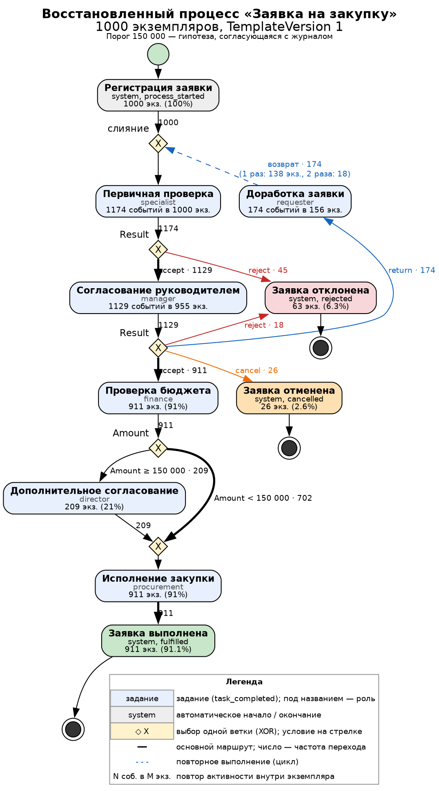

# Отчёт: восстановление процесса «Заявка на закупку» по журналу событий

**Файлы сдачи**

| Файл | Что это |
|---|---|
| `process_model.png` / `.svg` / `.dot` | схема восстановленного процесса (обязательная часть 1) |
| `report.md`, `report.pdf` | этот отчёт (часть 2) |
| `variants.csv` | таблица полных вариантов: 8 вариантов, 1000 экземпляров, сумма долей 1.0 (часть 3) |
| `student_transitions.csv` | 12 пар непосредственно следующих активностей (часть 4) |
| `analyze.py`, `run_log.txt` | код и полный вывод проверок; на него ссылаются все числа отчёта (часть 5) |
| `dfg.png`, `alpha_net.png` | автоматические модели для усложнённой части |

## 1. Как обрабатывался журнал

Инструменты: Python 3 и pandas. Рисунки строит Graphviz `dot`. Специальные библиотеки Process Mining не использовались: DFG и алгоритм Alpha реализованы в `analyze.py` (около 40 строк), так что каждый шаг можно проверить.

Запуск: `python3 analyze.py` в папке с `students (2).csv`. Скрипт пересоздаёт все CSV, рисунки и `run_log.txt`. При повторном запуске расчёты и CSV совпадают; порядок вывода множеств и расположение элементов автоматической сети могут отличаться.

Шаги:
1. Чтение CSV как текста (UTF‑8 с BOM). `EventIndex` переводится в число. Строки группируются по `ProcessInstanceId` и сортируются по **числовому** `EventIndex`.
2. Проверка данных (`run_log.txt`, раздел 1):
   - 6508 событий, 1000 экземпляров, одна версия шаблона `TemplateVersion = 1`;
   - `EventIndex` идёт 1…n без пропусков, и время по нему не убывает;
   - в каждом экземпляре ровно один `process_started` (первым) и один `process_completed` (последним);
   - `ActivityId` и `ActivityName` соответствуют один к одному;
   - сумма внутри экземпляра не меняется;
   - у каждого человеческого задания свой `TaskId`. Значит, повторы — это новые выполнения, а не дубли, и они **сохранены**.
3. Трасса экземпляра — это последовательность `ActivityName`. Из трасс получены варианты, присутствие активностей по исходам, DFG (пары a→b), а также DFG с учётом `Result` источника.
4. Каждую развилку проверяли по двум вопросам: что её определяет (`Result`, `Amount`) и есть ли исключения.
5. Автоматические модели (DFG, Alpha) сравнивались с ручной схемой. Для сравнения использовались воспроизведение трасс и перебор поведения, которое модели допускают.

## 2. Активности, начала и окончания

10 активностей. У каждой одна роль исполнителя (проверено crosstab «активность × роль»).

| Активность | Тип / роль | Событий | Экземпляров | Где встречается |
|---|---|---|---|---|
| Регистрация заявки | process_started / system | 1000 | 1000 | **всегда**, всегда первая |
| Первичная проверка | task / specialist | 1174 | 1000 | **всегда**, всегда вторая; повторяется после доработки |
| Согласование руководителем | task / manager | 1129 | 955 | всегда, кроме 45 заявок, отклонённых на первичной проверке |
| Доработка заявки | task / requester | 174 | 156 | только после возврата руководителем (15.6 % заявок) |
| Проверка бюджета | task / finance | 911 | 911 | **во всех выполненных** заявках и только в них |
| Дополнительное согласование | task / director | 209 | 209 | **во всех выполненных заявках с Amount ≥ 150 000** и только в них |
| Исполнение закупки | task / procurement | 911 | 911 | во всех выполненных и только в них |
| Заявка выполнена | process_completed / system, `fulfilled` | 911 | 911 | окончание, 91.1 % |
| Заявка отклонена | process_completed / system, `rejected` | 63 | 63 | окончание, 6.3 % |
| Заявка отменена | process_completed / system, `cancelled` | 26 | 26 | окончание, 2.6 % |

- **Начало:** всегда `Регистрация заявки` (1000/1000), за ней всегда `Первичная проверка` (1000/1000).
- **Окончания (3 штуки):** последнее событие — всегда `process_completed` с одним из трёх названий. Что стоит перед окончанием:

| Перед окончанием | Окончание | Экземпляров |
|---|---|---|
| Исполнение закупки | Заявка выполнена | 911 |
| Первичная проверка (`reject`) | Заявка отклонена | 45 |
| Согласование руководителем (`reject`) | Заявка отклонена | 18 |
| Согласование руководителем (`cancel`) | Заявка отменена | 26 |

  Системное событие окончания идёт через 2–9 с после последнего задания. Все 4508 человеческих завершений попадают в рабочее время пн–пт 09–18.

## 3. Переходы и развилки

Все 12 наблюдаемых пар a→b есть в `student_transitions.csv` и на схеме. Других пар в журнале нет.

| # | Развилка (XOR) | Чем определяется | Ветки (сколько раз) |
|---|---|---|---|
| G1 | после «Первичной проверки» | `Result` проверки | accept → Согласование руководителем (1129); reject → Заявка отклонена (45) |
| G2 | после «Согласования руководителем» | `Result` согласования | accept → Проверка бюджета (911); return → Доработка заявки (174); reject → Заявка отклонена (18); cancel → Заявка отменена (26) |
| G3 | после «Проверки бюджета» | `Amount` | ≥ 150 000 → Дополнительное согласование (209); < 150 000 → Исполнение закупки (702) |

- В G1 и G2 значение `Result` **однозначно** задаёт следующую активность. Исключений нет: в `run_log`, раздел 4, проверка возвращает «True».
- В G3 результат у бюджета всегда `accept`, поэтому ветку выбирает не он. Ветку выбирает сумма:
  - без доп. согласования максимум 149 743.41 (`4794f856-…`);
  - с доп. согласованием минимум 150 614.59 (`7c26c98e-…`);
  - правило «доп. согласование ⇔ Amount ≥ 150 000» выполняется во всех 911 заявках, дошедших до бюджета.
- Другие зависимости от суммы не установлены: сравнение медиан по исходу и числу возвратов само по себе не доказывает независимость.
- **Слияния** (XOR-join), то есть активности с несколькими предшественниками:
  - `Первичная проверка` ← Регистрация (1000) / Доработка (174);
  - `Исполнение закупки` ← Проверка бюджета (702) / Доп. согласование (209);
  - `Заявка отклонена` ← Первичная проверка (45) / Руководитель (18).
- **Наблюдаемые последовательности согласуются с последовательной моделью с XOR-шлюзами.** В журнале нет ни одной пары, наблюдаемой в обоих порядках (a→b и b→a). Это не доказывает отсутствие параллельной работы: журнал содержит только завершения заданий.

## 4. Возвраты и повторные выполнения

- Единственный цикл: `Согласование руководителем (return) → Доработка заявки → Первичная проверка → Согласование руководителем`. После возврата всегда идёт именно этот фрагмент. Проверка с доработки начинается заново, а не с руководителя.
- Число доработок на заявку: 0 у 844 заявок, 1 у 138, 2 у 18 (всего 174 события в 156 заявках). Больше двух не встречается. Первичная проверка и согласование выполняются до 3 раз.
- Решения по номеру прохода (`run_log`, раздел 6):

| | 1-й проход | 2-й проход | 3-й проход |
|---|---|---|---|
| Первичная проверка | accept 955, reject 45 | accept 156 | accept 18 |
| Согласование руководителем | accept 755, return 156, reject 18, cancel 26 | accept 138, return 18 | accept 18 |

**Наблюдаемый факт:** после доработки ни разу не было отказа или отмены (0 из 174 повторных проверок и 0 из 174 повторных согласований). При независимых решениях с вероятностями отказа/отмены как на первом проходе (≈4.5 %) вероятность нуля таких исходов составила бы ≈3·10⁻⁴ для каждого вида заданий. Это ориентировочный расчёт: повторные решения внутри заявки могут зависеть друг от друга, а доработка — менять вероятность отказа. Отсутствие отказов в выборке не доказывает запрет в системе.

## 5. Варианты и частоты

Сокращения: R — регистрация, C — первичная проверка, M — руководитель, D — доработка, B — бюджет, X — доп. согласование, P — исполнение.

| Вариант | Маршрут | Случаев | Доля | Пример ProcessInstanceId |
|---|---|---|---|---|
| V1 | R C M B P → выполнена | 567 | 56.7 % | 00f3e3a0-9d7d-5eac-98a9-b605b6893e61 |
| V2 | R C M B X P → выполнена | 188 | 18.8 % | 01ae1813-1d99-5524-8f81-77ad5452c33e |
| V3 | R C M D C M B P → выполнена | 117 | 11.7 % | 015bf5dd-d3b4-5b89-8814-7ca369f74e92 |
| V4 | R C → отклонена | 45 | 4.5 % | 08a60c66-22dd-5cf8-90dd-71ba3d53f349 |
| V5 | R C M → отменена | 26 | 2.6 % | 00e3854b-efb6-59c7-ac6a-c85643843db1 |
| V6 | R C M D C M B X P → выполнена | 21 | 2.1 % | 055f6c87-61a2-52aa-86ec-940480c96dcd |
| V7 | R C M D C M D C M B P → выполнена | 18 | 1.8 % | 009608ae-1567-584a-b67a-c7ec60ec587d |
| V8 | R C M → отклонена | 18 | 1.8 % | 02bf4e3d-60b1-5713-9886-43fa49c67001 |

- Три частых варианта покрывают 87.2 % журнала. Полные названия активностей приведены в `variants.csv`: там 8 строк, они покрывают весь журнал (100 %).
- Редкие варианты V5–V8 (1.8–2.6 %) — законные ветки тех же развилок, а не ошибки.
- Медианная длительность экземпляра: около 3 дней у V1 и V2, 5–6 дней у вариантов с возвратами. Отказы и отмены укладываются в первый день.

## 6. Факт и гипотеза

**Факты из журнала** (с учётом класса заявок):
- начало R → C у всех 1000 заявок; далее M у 955, отклонение после C у 45;
- три наблюдаемые развилки: после C и M следующая активность определяется `Result`, после B ветка согласуется с условием по `Amount`;
- выход `B → X` только при сумме ≥ 150 000;
- цикл возврата через доработку;
- три окончания;
- отсутствие пар непосредственно следующих активностей, наблюдаемых в обоих порядках; параллельное выполнение по этому журналу не исключено.

**Гипотезы**, которые журнал не доказывает:
1. **Точный порог 150 000.** Журнал говорит только, что граница лежит между 149 743.41 и 150 614.59. Значение 150 000 выбрано как правдоподобное «круглое». Неизвестно и то, входит ли граница (`≥` или `>`).
2. **Ограничение на число возвратов.** Трёх возвратов не наблюдалось. Но при частоте возврата на 2-м проходе 11.5 % у 18 заявок ожидалось бы около 2 таких случаев, а вероятность не увидеть ни одного ≈ 0.11. Поэтому «не больше двух возвратов» — **не доказанное** правило. На схеме цикл нарисован без ограничения, с подписью о наблюдаемой кратности.
3. **После доработки руководитель не отклоняет и не отменяет.** В выборке таких исходов нет; условный расчёт вероятности приведён в разделе 4. Это может быть свойство выборки или поведения людей, а не запрет в системе. На схеме из G2 ветки reject/cancel не убраны для повторного прохода: схема описывает наблюдаемые переходы, а это ограничение указано здесь как наблюдение.
4. **Комбинация «2 возврата + доп. согласование» не встретилась.** Все 18 дважды возвращённых заявок имеют сумму < 150 000. При доле крупных заявок 22.8 % вероятность этого ≈ 0.009. Однако одиночный возврат с крупной суммой встречается (V6, 21 случай), поэтому, скорее всего, это редкая комбинация, а не запрет.
5. **Что выбирает руководитель (accept / return / reject / cancel) и проверяющий,** по данным журнала не определяется. Зависимость этих решений от суммы не установлена. В журнале нет полей, объясняющих решение, поэтому эти развилки — недетерминированные XOR «по решению исполнителя».
6. **Одинаковый порядок событий не доказывает внутреннее устройство.** Например, «Проверка бюджета» всегда стоит перед «Доп. согласованием». Это может быть как последовательный шаг, так и шлюз по сумме внутри системы, создающий задание директору. Журнал видит только завершения заданий: моменты создания и автоматические шлюзы в нём не записаны.

## 7. Автоматическая модель и сравнение (усложнённая часть)

**DFG** (`dfg.png`). Граф непосредственно следующих восстановил **все** 12 переходов, начало и окончания. Ровно эти пары и попали в CSV. Но DFG допускает больше поведения, чем было в журнале. Перебор путей длиной до 15 даёт 20 трасс, разрешённых DFG, при 8 наблюдаемых, то есть 12 лишних. Например:
- `R C M D C → отклонена` и `R C M D C M → отменена` — отказ после доработки (не наблюдался);
- `R C M D C M D C M D C M B P` — три и более возвратов;
- `R C M D C M D C M B X P` — два возврата вместе с доп. согласованием;
- ребро `B → X` в DFG разрешено при **любой** сумме. Граф не умеет выражать условие по данным, поэтому правило ≥ 150 000 находится только анализом атрибута `Amount`;
- DFG не различает проходы цикла и не показывает, что решение M однозначно задаётся полем `Result`.

**Алгоритм Alpha** (своя реализация, `alpha_net.png`) восстановил плохо, и это поучительно:
- Начало, окончания и цикл через `{Регистрация, Доработка} → Первичная проверка` найдены верно. В footprint нет пар a||b. Найден и XOR-выход руководителя `{M} → {D, отклонена, отменена, B}`.
- Но развилки G1 и G3 превратились в **параллельные** ветки. Активности `M` и `Заявка отклонена` связаны прямым переходом M→отклонена, поэтому Alpha не может поместить их в одно место после `C`. Он создаёт два отдельных места `{C}→{M}` и `{C}→{отклонена}`, и `C` порождает две фишки (AND-split). То же происходит с `{B}→{X}` и `{B}→{P}`, потому что есть переход X→P.
- Итог: сеть Alpha без ошибок воспроизводит только **18 из 1000** трасс (вариант V8). Это известное ограничение Alpha: он не умеет работать с XOR-ветками, одна из которых «перепрыгивает» другую (skip / short-cut). В ручной схеме эту проблему снимают явные XOR-шлюзы.

Вывод: автоматический DFG годится, чтобы найти переходы и проверить ручную схему, и все его рёбра совпали с ручной моделью. Развилки, условия по данным и ограничения цикла получены только из ручного анализа атрибутов `Result` и `Amount` по проходам.

## 8. Ограничения и роль AI

- Журнал синтетический, в нём одна версия шаблона и 1000 завершённых экземпляров. Редкие комбинации (3 возврата, 2 возврата с крупной суммой) могли просто не попасть в выборку.
- Время между событиями включает очередь и нерабочие часы. Поэтому длительности в `run_log`, раздел 7, нельзя считать трудозатратами.
- Анализ, скрипт и отчёт подготовлены с помощью AI-ассистента (Claude). Как проверялись выводы:
  - все числа отчёта взяты из вывода `analyze.py`, а не из ответа модели;
  - каждое утверждение «всегда / никогда» проверено отдельной проверкой на полном журнале (`run_log.txt`);
  - примеры экземпляров можно найти в исходном CSV по `ProcessInstanceId`;
  - результат автоматического Alpha проверен воспроизведением трасс, что и выявило его ошибку.
